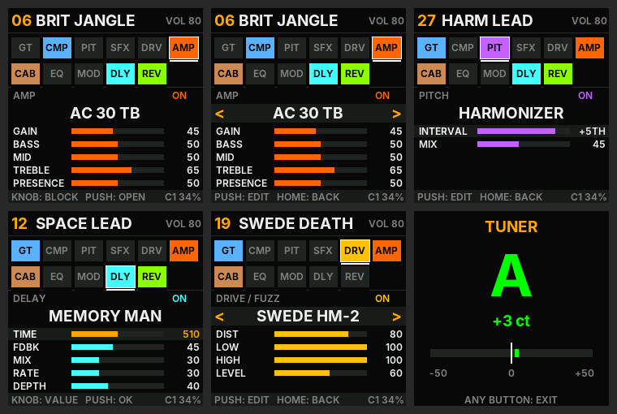

# OpenPocket
install here "experimental version only tested on the donner pocket-x. AT YOUR OWN RISK for the m-vave blackbox" : https://isod89.github.io/openpocket/
**Open-source guitar multi-effects firmware for the Donner Pocket X and the M-VAVE BlackBox.**
Written from scratch for the pedal's own chip (JieLi AC791N, two cores), installable from the browser.

*[Français plus bas](#français)*

## What it does

- **11-block chain, 118 models**: GATE → COMP → PITCH → SPECIAL FX → DRIVE → AMP → CAB → EQ → MOD → DELAY → REVERB
- **29 amps** (Twin, Deluxe, Princeton, Tweed Bassman, Champ, AC30, AC15, JTM45, Plexi, JCM800, JVM, Hiwatt, Orange,
  Matchless, Dumble ODS, SLO, Mark IIC+, Rectifier, 5150 / 5150 III, Ecstasy, Friedman BE, VH4, Powerball, Revv,
  JC-120, Supro, Two-Rock, SVT), tube stages oversampled ×4, real tone stacks, power-amp sag, all level-matched
- **15 cabinets** (Greenback, V30, T75, H30, Alnico Blue, Jensen, Cream, JBL 15", 8x10 bass…) with a MIC position
- **27 drives / fuzzes / boosts** (TS808, TS9, SD-1, Klon, BD-2, OCD, RAT, DS-1, Distortion+, Bluesbreaker, King of
  Tone, Timmy, Zendrive, three Big Muffs, two Fuzz Faces, Tone Bender, Octavia, Fuzz Factory, Rangemaster, EP Booster,
  HM-2, Metal Zone, Precision Drive, B7K)
- **11 modulations, 8 delays, 8 reverbs**, octaver / polyphonic octave / Whammy / harmonizer / detune, envelope filter,
  ring modulator, bitcrusher, slicer, square-wave synth, 4 compressors, 3 EQs
- **42 preset slots you can overwrite** (hold PUSH = SAVE; power-cut safe, kept across updates), 42 factory presets
  (one per style), a flicker-free colour UI, a chromatic tuner
- **Detailed cabinets** (cone breakup, off-axis mic comb, open-back reflection) and **tube stages with bias shift**
  (the note compresses on a hard attack and blooms back)
- **24-bit audio** in and out, guitar read from the left input channel only, like the official firmware (the right
  channel only carries noise: mixing it in was the constant hiss on high-gain amps)
- **USB update**: the pedal shows up as a USB-MIDI device and takes updates from the [web installer](docs/index.html)

Full list of models and controls (French): [docs/SONS-ET-COMMANDES.md](docs/SONS-ET-COMMANDES.md).

## Install

Open the installer page (GitHub Pages of this repository) in **Chrome or Edge** on a computer, plug the pedal in over
USB, press **Connect**, then **Install**. The page also takes the pedal back to the official firmware: pick the
official `.fwsc` from the maker, it is checked in the browser.

On the **Donner Pocket X** the page works: updating OpenPocket → a newer OpenPocket is tested (2026-11-02, your saved
presets are kept), and other Pocket X owners have installed it from the page. On the **M-VAVE BlackBox** it has not
been tried yet: install at your own risk. It is the same JieLi update system as the M-VAVE FM-1, where this method is
used by Felucca, CLIPPER and SLOOP. Keep the SD-card recovery at hand (`flash/`: fm1buddy on an ESP32-S3,
`makeimage.bat`).

## Build

Windows: install WSL and the JieLi toolchain once (`wsl bash firmware/setup.sh`), then run **`build.bat`**. It makes:

- `firmware/openpocket.bin`, the app;
- `docs/firmware/PocketX_9NN.fwsc`, `BlackBox_9NN.fwsc`, `manifest.json`, the installer's packages
  (`tools/pxpkg.py`, with the update loader built from `loader/`);
- `fm1-300.bin` only if your factory backup `fm1-1.bin` is in the folder (SD-card recovery image).

Linux: `JIELI_TOOLCHAIN=~/.jieli/toolchain firmware/build.sh`.
**`PUBLISH-GITHUB.bat`** then publishes the source, a release with the packages, and the installer on GitHub Pages.

## Test (no pedal needed)

`tests/run_tests.sh [PocketX_016.fwsc]` checks, on the PC:

- the preset store on a simulated flash, with a power cut at every step of a save;
- the sound engine with the pedal's own math library: every block × model × extreme setting, no NaN, nothing runs away;
- the package builder: it rebuilds the official PocketX 016 app area **byte for byte** (with the official file);
- the installer against a **simulated pedal** that runs the pedal's real update code (`ota.c`, then the loader's
  `ldr_core.c`) on a simulated flash: update, install over the official firmware, wrong model refused, damaged package
  refused before anything is erased, way back to the official firmware (its loader staged and checked);
- the page itself in headless Chromium (Playwright), clicking Connect and Install.

## Layout

| | |
| --- | --- |
| `engine/` | the sound engine (`px_dsp.c`), portable C, float |
| `firmware/` | the pedal app: screen, controls, audio (I2S), USB, UI (`ui.h`), board support (`bsp/`, felucca-bsp) |
| `loader/` | the update loader (runs from RAM, writes the app area) |
| `docs/` | the web installer (GitHub Pages) and documentation |
| `tools/` | package builder, loader wrapper, font converter, flash image tools |
| `tests/` | host tests and the simulated pedal |
| `flash/` | SD-card recovery with fm1buddy (ESP32-S3) |

## Licence

GPL-3.0-only. Board support and loader: MPL-2.0 (felucca-bsp). JieLi SDK files: Apache-2.0. Inter: OFL 1.1.
See [NOTICE.md](NOTICE.md). Not affiliated with Donner or M-VAVE. Install at your own risk.

---

## Français

**OpenPocket** est un firmware multi-effets guitare open source pour la **Donner Pocket X** et la **M-VAVE BlackBox** :
11 blocs, 118 modèles (29 amplis, 15 baffles, 27 drives/fuzz/boosts, 11 modulations, 8 delays, 8 reverbs, effets de
hauteur et effets spéciaux), 42 emplacements de presets enregistrables (appui long sur PUSH = SAVE, gardés après une
mise à jour), interface couleur sans clignotement, accordeur.

- **Installer** : ouvre la page d'installation dans Chrome ou Edge, branche la pédale en USB, **Connecter**, puis
  **Installer**. Retour au firmware officiel : choisis le fichier `.fwsc` officiel, il est vérifié dans le navigateur.
  Sur la **Pocket X**, la page fonctionne (mise à jour testée le 2026-11-02, presets gardés ; d'autres utilisateurs
  l'ont installée). Sur la **BlackBox**, pas encore essayé : à tes risques. Garde la récupération par carte SD.
- **Compiler** : `build.bat` (WSL + toolchain JieLi, installé une fois par `firmware/setup.sh`).
- **Publier** : `PUBLISH-GITHUB.bat` (code source, release avec les paquets, page d'installation sur GitHub Pages).
- **Tester sans pédale** : `tests/run_tests.sh`.
- Liste complète des sons et des commandes : [docs/SONS-ET-COMMANDES.md](docs/SONS-ET-COMMANDES.md).
