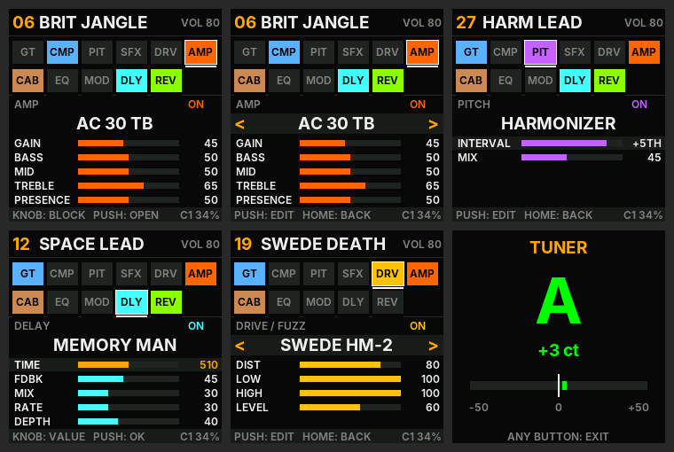

# OpenPocket — sounds and controls (v29)

## The chain (12 blocks, 129 models)
Default order: `GT → CMP → PIT → SFX → SYN → DRV → AMP → CAB → EQ → MOD → DLY → REV`

Since v29 every preset has its own block order: **double-click PUSH** on the chain to grab the selected block, turn
the knob to move it, PUSH to drop it (HOME puts it back). Delay before the amp, wah after the drive, octaver after
the fuzz... The order is saved with the preset. DRV and AMP share one oversampled section when AMP comes right after
DRV; elsewhere each runs its own.

Each block has a **type** (the model), an **ON/OFF** state and up to **5 settings (0–100)**. Where a bare number
would mean nothing, the screen shows the real value: interval (`+5TH`), semitones (`-7`), time in ms (`510`),
playback heads (`1+2`), EQ dB (`+6`), bits (`8`), `SLOW`/`FAST` for the rotary.

The names refer to the famous units the sounds are inspired by (voicings taken from published circuit analyses:
ElectroSmash, Electric Druid, R.G. Keen, Rob Robinette, Duncan's Tone Stack Calculator, Celestion/Jensen/EV/JBL
curves, Boss/Roland/Ampeg/EHX manuals). They are simplified digital models, not copies.

### AMP — 29 amps (GAIN, BASS, MID, TREBLE, PRESENCE)
| Family | Models (inspired by) |
|---|---|
| American clean | TWIN CLEAN (Twin Reverb), DELUXE 65 (Deluxe Reverb), PRINCETONE (Princeton), TWO-ROCK (boutique clean) |
| Tweed / small amp | TWEED 59 (Bassman 5F6-A), TWEED CHAMP (Champ), SUPRO 64 (Supro, heavy sag) |
| British chime | AC 30 TB (AC30 Top Boost), AC 15, CHIME 30 (Matchless) |
| British rock | JTM 45, PLEXI 68 (Super Lead), BRIT 800 (JCM800), BRIT JVM, HIWATT DR (big headroom), ORANGE 120 |
| Boutique lead | ODS LEAD (Dumble), SLO 100 (Soldano), ECSTASY (Bogner), BE LEAD (Friedman), MARK IIC+ (Mesa) |
| Modern / metal | RECTIFIED (Dual Rectifier), 5150 LEAD, 5150 III, UBER VH4 (Diezel), EURO BALL (Engl), REVV GEN |
| Solid state / bass | JC CLEAN (Jazz Chorus, no breakup), SVT BASS (Ampeg SVT) |

Each amp = 0 to 4 preamp stages (gain, asymmetry, RC filters per stage) oversampled ×4, input filter (tightness),
a "bright" cap that fades as the gain goes up, a tone stack at its own frequencies (mid scoop at noon: −6 dB Fender,
−3 dB Marshall, −6 dB Mesa…), presence, resonance, power-stage saturation and supply sag. All 29 amps are
level-matched (±0.1 dB).
Since v25: asymmetric triode curve (the positive half-wave limits earlier: 2nd harmonic from −35 to −24 dB on the
Plexi, from −33 to −18 dB on the 5150), bias shift that follows your playing (the note compresses on a hard attack,
then blooms back in about 100 ms), and supply sag that reaches the preamp too.

### CAB — 15 cabinets (BODY, BRIGHT, MIC)
1x10 OPEN · 1x12 US OPEN (Jensen C12N) · 2x10 VIBRO · 2x12 BLUE (Alnico Blue) · 2x12 BRIT (G12H) ·
4x10 TWEED (Bassman) · 4x12 GREEN (Greenback) · 4x12 T75 · 4x12 V30 (Vintage 30) · 4x12 H30 · 1x12 CREAM ·
1x15 OPEN (JBL D130) · 8x10 BASS (SVT) · 4x10 HORN (bass + tweeter) · DI (NO CAB).
Speaker resonance, presence dips and peaks taken from the makers' curves. **MIC** moves the mic from the edge
(dark) to the centre (bright).
Since v25 each cabinet also has a detail layer: the cone's breakup resonances between 1.2 and 6 kHz (specific to
each model, so two cabinets no longer sound alike in the highs), the comb filtering of an off-axis mic (MIC 0 = cone
edge: dip around 6 kHz; MIC 100 = centre: out of the audio band) and the rear wave of open-back cabinets (1x10,
1x12 US, 2x10, 2x12 BLUE, 4x10 TWEED, 1x15). Since v27 it is computed with resonators instead of a 128-tap filter:
same sound, much lighter on the pedal.

### DRV — 27 drives, fuzzes and boosts
| Family | Models | Settings |
|---|---|---|
| Overdrive | TS 808, TS 9, SD-1 OD, KLONE, BD BLUES, OCD DRIVE, BLUESBREAKER, KING OF TONE, ZEN DRIVE (VOICE), TIMMY (BASS, TREBLE) | DRIVE, TONE, LEVEL |
| Distortion | RAT DIST, DS-1 DIST, DIST PLUS, SWEDE HM-2 (LOW, HIGH), METAL ZONE (LOW, HIGH) | DIST, TONE, LEVEL |
| Fuzz | MUFF PI, RAMS HEAD, GREEN RUSSIAN, FACE GERMAN., FACE SILICON, BENDER MK2, OCTAFUZZ (upper octave), FUZZ FACTORY (GATE, BIAS: sputters) | SUSTAIN/FUZZ, TONE, LEVEL |
| Boost / bass | TREBLE BOOST (Rangemaster), EP BOOST, PRECISION (TIGHT, BRIGHT: metal boost), BASS DI 7K (BLEND) | BOOST/DRIVE, TONE, LEVEL |

Each drive follows its circuit: input filter, the TS "shelf" (the lows don't clip), clipping type (soft,
asymmetric, hard diodes, germanium, LED, MOSFET, the Muff's two stages, starved transistor, rectifier), original
tone control (low-pass, the Muff's and DS-1's LP/HP blend, the HM-2's peaks). Level-matched: at noon every drive
comes out at the same level as the guitar (boosts: +6 dB).

### SYN — 11 synths, keyboards and other guitars (v29)
Played with a normal guitar: no special pickup, no MIDI.

| Family | Type | Settings | How it works |
|---|---|---|---|
| Keyboards (chords OK) | ORGAN | 16', 8', 4', PERC, DRY | drawbars: −1 octave, the guitar's own pitch, +1 octave; key click; percussion (+19 semitones, decaying) |
| | CHURCH ORGAN | 16', 8', 4', 2', DRY | pipe organ: slow speech, long release, slight celeste |
| | STRINGS | ATTACK, RELEASE, OCTAVE, TONE, DRY | tape-replay / string machine: swell, +1 octave layer, 3-voice ensemble |
| | CHOIR | ATTACK, RELEASE, VOWEL, OCTAVE, DRY | the strings through vocal formants, "ooh" (0) to "aah" (100) |
| Synths that follow your note (one note at a time) | MONO SYNTH | WAVE, OCTAVE, CUTOFF, RESO, ENV | pitch tracker → band-limited saw / square / pulse → 24 dB resonant ladder filter with envelope |
| Synths that follow the waveform (no delay) | PWM SYNTH | WIDTH, RATE, CUTOFF, RESO, MIX | the guitar turned into a pulse wave whose width moves, then the ladder filter |
| | BASS SYNTH | OCT -1, OCT -2, CUTOFF, ENV, DRY | square waves one and two octaves down, filter swept by each attack |
| Other guitars | 12-STRING | OCTAVE, DETUNE, TONE | thin octave strings, slightly out of tune, plus the doubled unison strings |
| | ACOUSTIC | BODY, BASS, TREBLE, ROOM | magnetic pickup → flat-top: body resonance (parlour to jumbo), top, sparkle, body reflections |
| | SITAR | KEY, BUZZ, SYMPATH, DECAY | bridge buzz (jawari) + 6 sympathetic strings tuned to KEY |
| | BARITONE | TUNE, TONE, MIX | the whole guitar 1 to 12 semitones down |

Keyboards hold the note while the string sounds (like a key held down) and release when it dies away or when you
mute it. MONO SYNTH needs single notes: it finds the pitch in 30–80 ms and is accurate to a few cents.

### Effects
| Block | Types |
|---|---|
| GT | NOISE GATE (THRESH, RELEASE) |
| CMP | SQUASH (Dyna Comp), STUDIO (parallel, MIX), OPTO LA-2 (optical, slow release), SLOW SWELL (attack removed: violin effect) |
| PIT | OCTAVER (analog: SUB -1, SUB -2, UP +1), POLY OCTAVE (clean −1 and +1 octave), WHAMMY (±24 semitones, GLIDE), HARMONIZER (fixed interval −OCT…+OCT), DETUNE (doubling ±cents) |
| SFX | ENVELOPE WAH (Mu-Tron), AUTO WAH (LFO, or fixed wah with DEPTH 0), RING MOD, BITCRUSHER, SLICER (8 rhythm patterns), LO-FI RADIO, SQUARE SYNTH (square-wave synth + sub, opening filter) |
| EQ | 5 BAND, GRAPHIC 5 (the Mesa "V"), PARAMETRIC |
| MOD | CE CHORUS, DIMENSION (4 modes), FLANGER, PHASE 90, SMALL STONE, UNI-VIBE, OPTO TREMOLO, BIAS TREMOLO, HARMONIC TREM, ROTARY (Leslie, real SLOW↔FAST ramp), VIBRATO |
| DLY | DIGITAL, ANALOG BBD, MEMORY MAN (modulated repeats), TAPE EP-3 (wow & flutter), SPACE ECHO (3 heads, 7 combinations), REVERSE, LO-FI, DUAL TAP (quarter + dotted eighth) — TIME 20–1000 ms |
| REV | ROOM, HALL, CATHEDRAL, PLATE, SPRING (DRIP), SHIMMER (octave in the tail), GATED (80s), AMBIENT (up to 20 s) |

The analog/tape delays (ANALOG, MEMORY MAN, TAPE, SPACE ECHO, LO-FI) **self-oscillate above FDBK ≈ 90**, like the
real ones: lower FDBK to stop it.

## 52 factory presets (one per style)
01 GLASS CLEAN · 02 JAZZ BOX · 03 COUNTRY SNAP · 04 TEXAS BLUES · 05 TWEED BLUES · 06 BRIT JANGLE · 07 60S PSYCH ·
08 70S ROCK · 09 80S HAIR · 10 BRIT CRUNCH · 11 SMOOTH LEAD · 12 SPACE LEAD · 13 DOTTED 8TH · 14 MARK SOLO ·
15 THRASH · 16 GROOVE METAL · 17 DJENT · 18 DOOM SLUDGE · 19 SWEDE DEATH · 20 SHOEGAZE · 21 SWELL PAD ·
22 FUNK WAH · 23 SURF · 24 SWAMP TREM · 25 VIBE ROCK · 26 ROTARY ORGAN · 27 HARM LEAD · 28 WHAMMY DIVE ·
29 OCTA FUZZ · 30 SQUARE SYNTH · 31 RING MOD · 32 LO-FI TAPE · 33 STUTTER FUZZ · 34 BITCRUSH · 35 BASS DRIVE ·
36 BASS OCTAVE · 37 TWEED CHAMP · 38 HIWATT STACK · 39 MODERN HIGH · 40 SUPRO GRIT · 41 STONER FUZZ · 42 CHIME CLEAN ·
43 B3 ORGAN · 44 CHURCH ORGAN · 45 MELLO STRINGS · 46 CHOIR PAD · 47 MONO LEAD · 48 PWM SYNTH · 49 SYNTH BASS ·
50 12-STRING · 51 ACOUSTIC · 52 SITAR

## Controls
| Control | Action |
|---|---|
| KNOB (PARA) | chain: pick the block · block page: pick the line · editing: change the value (turn fast = steps of 5) |
| PUSH (knob) | chain → open the block · type/setting line → edit · ON/OFF line → toggle · while editing → confirm |
| PUSH **double-click** (chain) | **MOVE** the selected block: knob = move it, PUSH = drop, HOME = put it back |
| PUSH **long press (0.8 s)** | **SAVE**: store the current sound (see below) |
| HOME | back to the chain · **long press (0.7 s) = tuner** |
| Right / left footswitch | next / previous preset |
| AMP, CAB, DLY, REV, MOD | jump to the block; press again = on/off |
| FX | steps through DRV → SFX → SYN → PIT → CMP → GT → EQ |
| MASTER | output volume |

Bottom right: `C1 xx%` = DSP load on the second core (`C0` = fallback on the main core, `BYP` = overload guard:
turn a block off).

## Saving your sounds (v25)
- A `*` at the top of the screen means the sound has been edited since the preset was loaded.
- **Long press on PUSH**: SAVE page. The knob picks the slot (1 to 52; the current preset is offered first; the
  screen shows the name of the sound that will be replaced), PUSH saves, HOME cancels.
- At the very end of the list: **RESTORE FACTORY** puts the current slot back to its factory preset.
- The pedal starts on the slot saved last.
- Sounds are kept in flash (0xF0000–0xF4000, two copies): a power cut during a save leaves the previous version,
  never a damaged slot. They **survive OpenPocket updates** (the update loader only writes the app area). The sound
  is muted for about 0.1 s while saving. The block order is saved too. Sounds saved with v25–v28 are converted at
  the first start of v29 (the SYN block off, the default order).

## Tuner
Long press on HOME. The `IN L … R … dB` line at the top shows the level of each input channel (dB below full
scale): with nothing plugged in, it is the pedal's own noise floor; while playing, it is your guitar's level.

## Audio input (v26–v28)
Like the official firmware: input and output in 24 bits (v26), and the guitar read from the left channel only (v28).
The right input channel only carries constant noise (−77 dB); before v28 it was mixed into the sound, and the
high-gain amps turned it into a constant hiss, even with nothing plugged in.

## Checks run on the PC (with the pedal's own math library, `firmware/px_math.c`)
- 3,312 configurations (every block × type × extreme settings, changed while playing; signal, silence, very loud
  signal): 0 NaN.
- 354 long runs (3 s plucked string + 8 s of silence, every model at full settings): nothing runs away; only the
  delays at FDBK 100 keep repeating (by design).
- Pitch shifters: 100 % of the energy on the target note (440 Hz, 110 Hz, −7 semitones) thanks to phase alignment
  at every crossfade (SOLA).
- Digital silence: no more denormal numbers (silence used to cost 25× more CPU on the PC).
- Memory: engine 327 KB in the 344 KB POOL area.
- Preset saving (`tests/test_store.c`): power cut simulated at 1,286 points of a save → old version kept 578 times,
  new one 708 times, never a damaged slot; no write outside the preset area.
- CPU: v25 loaded the pedal too much (DOOM SLUDGE in BYP at 89 % on v26). v27 computes the cabinets and the amp
  differently (same sound, 0.5 dB on average): about −16 % on DOOM SLUDGE, −19 % on GROOVE METAL, i.e. +16 to +22 %
  over v24 (BYP guard at 85 %).

## USB update (v24)
Over USB the pedal shows up as a MIDI device named "OpenPocket". The installer page (`docs/index.html`, published
on GitHub Pages) recognises it, installs a new version or takes the pedal back to the official firmware. During an
update the screen shows `UPDATE` and the current step; if it fails, `FAILED -N`, then the pedal restarts on the
previous version (nothing is written before the pedal has checked the package).
